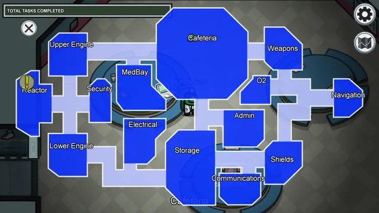

# The Napkin

**Gospel.** This is the owner's founding statement of the game, saved verbatim on 2026-11-13. Every spec, plan and review serves it. If a document contradicts the napkin, the document is wrong. Only the owner changes this file.

---

This is the among us map.  Each of these rooms has a thing to interact with, or a unique mini game.

What if the game play loop was "Play these mini games to operate a space ship in a pirates gameplay open world, together with friends"

In a Firefly setting like ex rebel in an Alliance controlled star system.

Choose to be a smuggler, pirate, merchant, or terrorist.

---

Notes (not part of the napkin):
- The image is a screenshot of another game's map, kept only as the owner's reference. It is never shipped, and the game's own art, names, maps and tasks stay original (foundation spec §12).
- The owner's later clarification (2026-11-13) and the direction built from the napkin are in `docs/superpowers/specs/2026-11-13-outlaw-crew-direction.md`.
